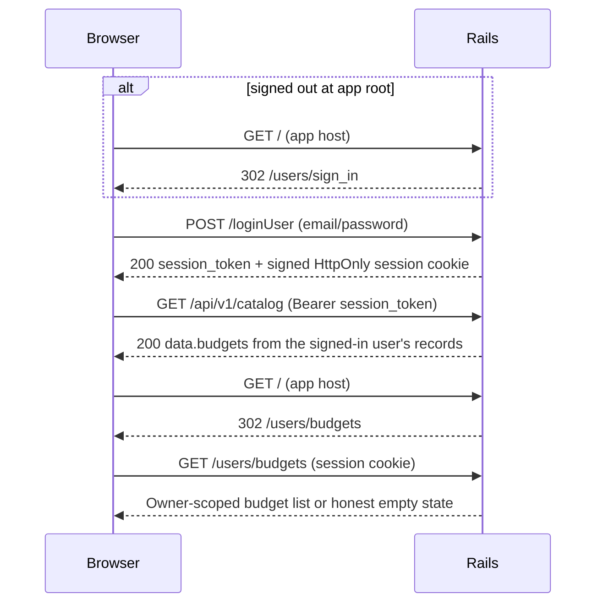

# Budgetify — Agent Guide

Last updated: 2026-10-08

## Current state

Budgetify is a Rails 8.1.4 budgeting app in active development. The public site and the authenticated app use separate host behavior:

- The root domain (including `www`) serves the marketing page.
- The `app` host serves the authenticated product. Signed-out requests to its root redirect to `/users/sign_in`.
- Successful login loads the signed-in user's catalog, then routes to `/users/budgets`.

The app uses email/password authentication only. Signup and Google/Apple authentication are intentionally not implemented.

## Login and budget-selection flow



The browser calls `syncCatalogData` after login and only navigates after the catalog endpoint returns a successful response. The token is stored in `sessionStorage`; the signed, HttpOnly cookie authenticates server-rendered app routes. API tokens are stored in the database as SHA-256 digests and can be revoked with `DELETE /v1/session`.

## Routes

| Method | Path | Purpose |
|---|---|---|
| `GET` | `/` on the root/`www` host | Public marketing landing page |
| `GET` | `/` on the `app` host | Redirect signed-out users to sign-in; send signed-in users to `/users/budgets` |
| `GET` | `/users/sign_in` | Email/password sign-in page |
| `POST` | `/loginUser` | API login; `200` on success, `401` with `error.id = "user_not_found"` on invalid credentials |
| `GET` | `/api/v1/catalog` | Bearer-authenticated catalog for the current user; currently lists persisted budgets |
| `GET` | `/users/budgets` | Session-authenticated, owner-scoped budget selector |
| `GET` | `/users/budgets/:public_id` | Open a budget owned by the current user |
| `DELETE` | `/v1/session` | Revoke the current bearer session |
| `GET` | `/v1/user` | YNAB-compatible `data.user.id` response |

The login response keeps the requested YNAB-style fields and omits `budget_version` and `user_budget`. External service and subscription metadata is null/false where the app has no source for it.

## Budget data

`Budget` records belong to a `User` and have a UUID `public_id` plus a name. The catalog and selector read real records and scope queries to the authenticated user. A new account with no budget records receives `data.budgets: []` and sees an empty state; the UI does not invent example budgets. Budgets can be created manually in the Rails console; there is no in-app creation workflow. Categories, transactions, and external catalog import are not implemented.

## Local development

```sh
bundle install
bin/rails db:prepare
bin/rails server
```

- Marketing page: `http://localhost:3000/`
- App host: `http://app.localhost:3000/`
- Sign-in page: `http://app.localhost:3000/users/sign_in`

Create a local account and a real budget in `bin/rails console` to exercise selection:

```ruby
user = User.create!(email_address: "you@example.com", password: "your-private-password", password_confirmation: "your-private-password")
user.budgets.create!(name: "Household")
```

In deployment, DNS and the reverse proxy must direct both the root domain and `app.<root-domain>` to this Rails application and terminate HTTPS.

## Verification

`bin/rails test` passes 26 tests and 106 assertions. The CI command `bin/rails db:test:prepare test:system` passes the browser test at `test/system/logins_test.rb` (1 test, 1 assertion). Browser smoke coverage also exercised catalog sync, app-host redirect, and budget selection.
